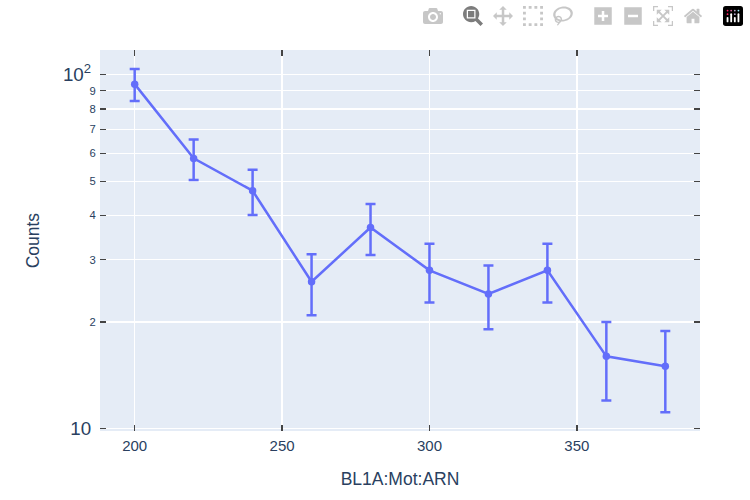
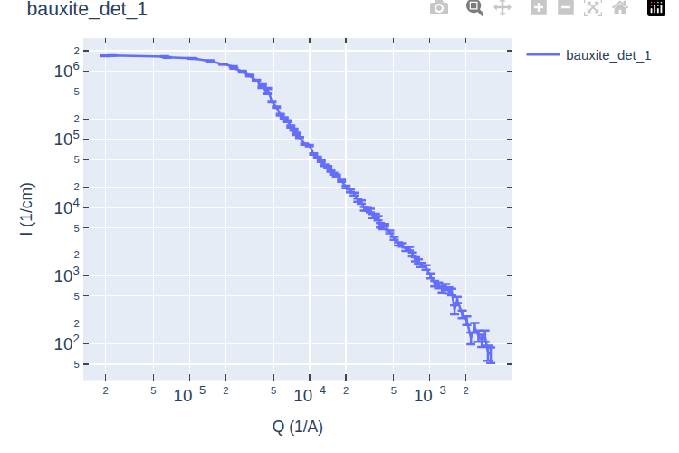

.. monitoring_runs

Monitoring Runs
===============

Once data collection for the current run completes,
the USANS autoreduction script automatically processes the data in two steps.
In the first step, the script preprocesses the raw neutron events,
and in the second step reduces the preprocessed data,
along with the data pertaining to the other runs in the sequence
of runs that the run belongs to.
The script uploads the ``I(Q)`` plot of the run-sequence for the main harmonic to the live data server,
which can be visualized at the URL of the run,
for example `https://monitor.sns.gov/report/usans/1234/` for run 1234.

Running the Script
------------------

The autoreduction script processes one run, given by its event file, and writes its output in an output directory:

.. code-block:: bash

   $ python -m usansred.reduce_USANS <event file> <output directory> [--no_publish]

For example:

.. code-block:: bash

   $ python -m usansred.reduce_USANS /SNS/USANS/IPTS-*****/nexus/USANS_1234.nxs.h5 \
         /SNS/USANS/IPTS-*****/shared/autoreduce

- ``<event file>``: the event file of the run, ``USANS_<run>.nxs.h5``.
- ``<output directory>``: the directory that receives the files of every run of the experiment.
  The same directory is given for every run, because the reduction of a sequence reads the files
  written for its earlier runs.
- ``--no_publish``: the figure of the run is saved in the output directory, but not uploaded to the
  live data server.

Users are not allowed to run the script. The script is run by SNS's monitoring system,
which is triggered by the completion of data collection for a run.

The runs are processed in the order in which they are recorded. Each run goes through two steps,
described below: the `preprocessing`_ of the run, and the `auto reduction`_ of its sequence.

The script ends with exit status 0 when the run is processed or skipped, and also when the event
file is not found, in which case it prints a message. It ends with status 1 when the processing
fails, and with status 2 when the command line is wrong.

Preprocessing
-------------

The preprocessing turns the raw neutron events of the Nexus file into the counts of the detectors and of the monitor,
against time of flight and against the angle of the analyzer, which are the files that the reduction
reads, and records the run in the files of its run-sequence.

Runs That Are Skipped
^^^^^^^^^^^^^^^^^^^^^

Measurements for a particular sample, or for an empty-cell,
are recorded as a sequence of runs, and the instrument control system writes in the event
file of each run the log ``BL1A:CS:Scan:USANS:FirstRun``. This is the run number of the first run of the
sequence that the run belongs to. This log is read first, without loading the events. A run whose log
is missing, or is 0 or below, such as the runs with ``FirstRun = -1`` recorded before each sequence,
is not part of any sequence (see :ref:`collecting run sequences <collecting-run-sequences>`).
It is skipped: nothing is written, and the script ends with exit status 0.

Output Files for Each Run
^^^^^^^^^^^^^^^^^^^^^^^^^

The NeXus file containing the events of the run is loaded,
and 21 text files are written in the output directory, each with a
header naming its columns. In the names, ``<run>`` is the run number,
``<motor>`` the short name of the motor scanned during the run, ``ARN`` for the rotation of the analyzer,
and ``<wavelength>`` the wavelength of the main time-of-flight region of the detector, in angstrom,
3.6 for most runs.

Counts against time of flight, from 0 to 17000 microseconds in bins of 10 microseconds, summed over
all pixels of the detector (see :ref:`transmission coefficient <transmission-coefficient>`):

- ``USANS_<run>_detector.txt``: the main detector, which receives the neutrons reflected by the
  analyzer.
- ``USANS_<run>_trans.txt``: the transmission detector, which receives the neutrons not reflected by
  the analyzer.
- ``USANS_<run>_detector_trans.txt``: both detectors together.
- ``USANS_<run>_monitor.txt``: the beam monitor.

Counts against the angle of the analyzer, in arcsec, one point per position of the motor:

- ``USANS_<run>_monitor_scan_<motor>.txt``: the beam monitor.
- ``USANS_<run>_detector_scan_<motor>_peak_<n>.txt``, for :math:`n = 1, \ldots, 6`: the main
  detector, in the time-of-flight region of harmonic :math:`n`, of wavelength 3.6, 1.8, 1.2, 0.9,
  0.72 and 0.6 angstrom. The reduction reads the files of harmonics 1 to 4, with the monitor file
  above.
- ``USANS_<run>_trans_scan_<motor>_peak_<n>.txt``, for :math:`n = 1, \ldots, 6`: the same for the
  transmission detector.
- ``USANS_<run>_detector_<wavelength>.txt`` and ``USANS_<run>_trans_<wavelength>.txt``: the main
  detector and the transmission detector, in the main time-of-flight region.

Detector counts divided by the monitor counts, against the momentum transfer :math:`Q`, in
``1/angstrom``, computed from the angle and the wavelength:

- ``USANS_<run>_iq_<motor>_<wavelength>.txt``: :math:`Q`, :math:`I(Q)` and its uncertainty, for the
  main time-of-flight region.
- ``USANS_<run>_iq_<motor>.txt``: the same for the six harmonics together, with the counts, the
  monitor counts and the wavelength of each point. Points without counts are left out.

The header of the two last files also gives the title of the run, its sequence, and its index in the
sequence.

Output Files for Each Sequence of Runs
^^^^^^^^^^^^^^^^^^^^^^^^^^^^^^^^^^^^^^

The run is recorded in two files of its sequence, where ``<N>`` is the value of ``FirstRun``, the
first run of the sequence:

- ``scan_<N>.json``: one entry per run of the sequence, with its title.
- ``sample_<N>.json``: the title and the thickness of the sample, in cm, from the log
  ``BL1A:CS:Scan:USANS:SampleThickness``. When the log is missing, is not a number, or is not above 0,
  the thickness is 0.1 cm.

These files are read by the `auto reduction`_.

The Raw Scan
^^^^^^^^^^^^

The counts of the main detector against the angle of the analyzer, in the main time-of-flight region
(``USANS_<run>_detector_<wavelength>.txt``), make the first panel of the figure of the run. The figure
is uploaded to the live data server under the run number, at the end of the `auto reduction`_.

         angle of the analyzer, BL1A:Mot:ARN, from 200 to 380 arcsec, for run 1234.
   :width: 75%

   Panel of the raw scan of a particular run:
   counts of the main detector against the angle of the analyzer, ``BL1A:Mot:ARN``, in arcsec.

Auto Reduction
--------------

After the preprocessing, the sequence of the run is reduced with the runs recorded so far, as
described in :doc:`Reducing One (or More) Experiments <reduce>`. Only that sequence is reduced; the
reduced data of the other sequences are left unchanged.

The Configuration Files
^^^^^^^^^^^^^^^^^^^^^^^

Two files configure the reduction, in the JSON format of ``reduceUSANS``, are written in the output directory:

- ``autoconfig_<N>.json``, the configuration file of the sequence that starts at run ``<N>``: the entry of the
  sequence alone, with the runs recorded up to the current run. This is the configuration file that is
  reduced.
- ``autoconfig.json``, the global configuration file: one sample per sequence of the experiment, in the order
  of their first run. The entry of a sequence is added at its first run, with ``start_scan_num`` the
  first run, and named after the title of that run, without a leading ``Align:``. At each later run of
  the sequence, ``num_of_scans`` grows to cover the runs from the first to the current one; the runs of
  that span that are not part of the sequence are listed in ``exclude``. The name and the other entries
  are not changed.

An example ``autoconfig.json`` is:

.. code-block:: json

   {
     "samples": [
       {"name": "bauxite", "start_scan_num": 1234, "num_of_scans": 6, "exclude": [], "thickness": 0.1},
       {"name": "EmptyCell", "start_scan_num": 1242, "num_of_scans": 6, "exclude": [], "thickness": 0.1},
       {"name": "diamond", "start_scan_num": 1251, "num_of_scans": 6, "exclude": [], "thickness": 0.1}
     ],
     "save_all_harmonics": false
   }

and ``autoconfig_1234.json`` holds the entry of ``bauxite`` alone.

Both files can be edited "by hand" during the experiment:

- ``autoconfig_<N>.json`` is created at the first run of its run-sequence, and copies entries ``background``,
  ``empty_cell`` and ``save_all_harmonics`` from ``autoconfig.json``,
  assuming any of these entries exists. A background or an empty cell
  added to ``autoconfig.json`` is therefore used by the sequences that start afterwards. At the later
  runs of the sequence, only the ``samples`` of ``autoconfig_<N>.json`` are replaced, so that a
  background or an empty cell added to it by hand is kept.
- If ``autoconfig.json`` or ``autoconfig_<N>.json`` cannot be read, for example after an edit that
  left it invalid, neither file is written, the reduction stops with an error naming the file, and
  the script ends with exit status 1. Correct the file, or remove ``autoconfig.json`` to have it built
  again from the ``scan_<N>.json`` files at the next run.

The Reduced Data
^^^^^^^^^^^^^^^^

The reduced data are written in the subdirectory ``auto`` of the output directory, for each sequence:

- ``<name>_det_1.txt`` and ``<name>_det_1_unscaled.txt``: the reduced data of harmonic 1 (see
  :ref:`units of the reduced data <units-of-reduced-data>`). The higher harmonics are only saved with
  ``save_all_harmonics``.
- ``<name>_det_1_background_subtracted.txt``: only when a background or an empty cell is subtracted.
- ``reduction_<name>.log``: the log of the reduction of the sequence.

``auto/summary.xlsx`` is written again at each run from ``autoconfig.json``, so that it covers every
sequence reduced so far, without the ``_unscaled`` files (see :ref:`the summary report <summary-report>`).

The Reduced Sequence
^^^^^^^^^^^^^^^^^^^^

:math:`I(Q)` of the reduced sequence, ``auto/<name>_det_1.txt``, makes the second panel of the figure
of the run, below `the raw scan`_. The figure is saved in the output directory as
``USANS_<run>.html``, and uploaded to the live data server under the run number, unless
``--no_publish`` is given. If the auto reduction fails, the figure holds the raw scan and, below it,
the message ``Reduction Failed`` with the traceback of the error, so that the cause can be read on the
live data server.

         about 2e-6 to 3e-3, of sample bauxite, titled bauxite_det_1.
   :width: 75%

   Panel of the reduced sequence of run 1234, uploaded to the live data server: :math:`I(Q)` of
   harmonic 1 of sample ``bauxite``, reduced from its six runs, 1234 to 1239.
