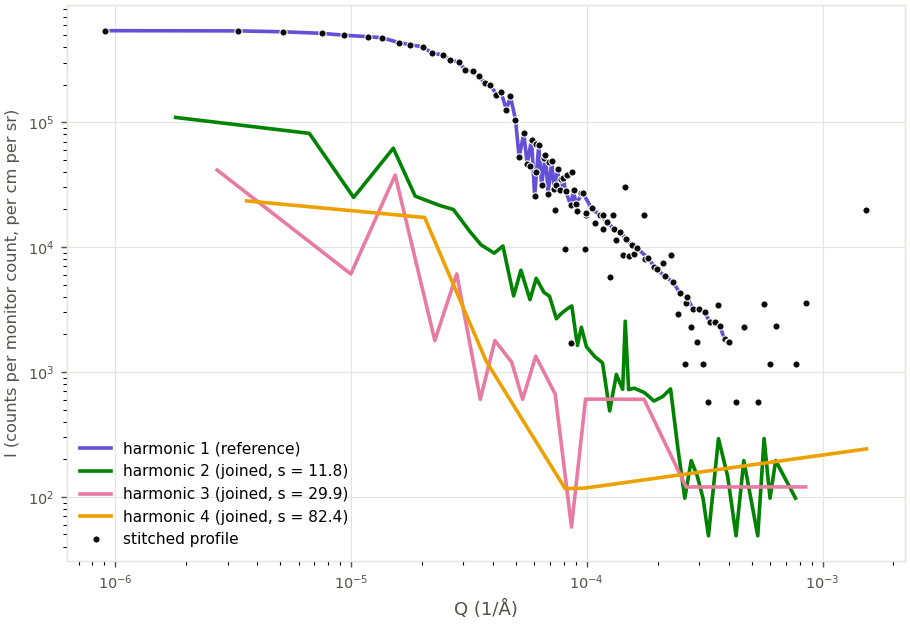
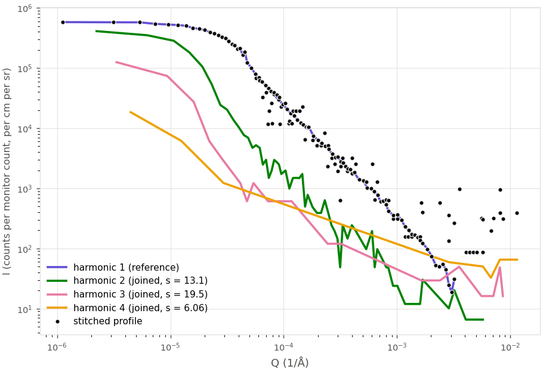

.. _stitching-harmonics:

Stitching the Harmonics
=======================

.. contents::
   :local:
   :depth: 1

When ``save_all_harmonics`` is enabled in the JSON setup file, the reduced profiles of all
harmonics of a measurement are combined into a single, continuous I(Q) profile. This is the last
step of the :doc:`reduction workflow <reduction_workflow>`, after background subtraction.

Since :math:`Q_n = (2\pi n / \lambda_1) \, |\theta - \theta_0|`
(see :doc:`reduction_workflow`), the same range of analyzer angles covers a Q range :math:`n`
times wider for harmonic :math:`n` than for harmonic 1. Adjacent harmonics therefore overlap in
Q, and each higher harmonic can extend the profile to higher Q. Stitching scales each harmonic
onto a common intensity scale, that of harmonic 1, and merges the harmonics into one profile.

Log messages written during stitching refer to the harmonics as *orders*. The stitching is
implemented in the :mod:`usansred.stitch` module (see the :doc:`API documentation <../api/usansred>`).

Procedure
---------

Harmonic 1 is the fixed reference. The harmonics are then joined one after another, in
increasing order: harmonic 2 is scaled onto harmonic 1, harmonic 3 onto the profile stitched
from harmonics 1 and 2, and so on. Each harmonic :math:`n` is joined onto the profile stitched
so far, the *reference profile*, in the following steps.

1. **Valid points.** Points with zero intensity (zero counts) are left out. They carry no
   information on the intensity scale of a harmonic, and they still have a non-zero uncertainty,
   since a count of zero is assigned an uncertainty of 1 (see :doc:`reduction_workflow`).
   Zero-count points are excluded from the Q range of each harmonic, from the count of points in
   an overlap, from the scale-factor fit, and from the stitched profiles.

2. **Overlap and fit range.** The overlap of harmonic :math:`n` with the reference profile is the
   intersection of their Q ranges, computed over valid points:

   .. math::

      Q_{min} = \max\left(Q^{ref}_{first}, Q^{n}_{first}\right), \qquad
      Q_{max} = \min\left(Q^{ref}_{last}, Q^{n}_{last}\right)

   where :math:`Q_{first}` and :math:`Q_{last}` are the lowest and highest Q of the valid points.
   Since every harmonic starts close to :math:`Q = 0`, the overlap usually spans most of the
   reference profile, including the peak of the unscattered beam. The shape of that peak is set
   by the instrument resolution, which is narrower for each higher harmonic, so the ratio of two
   harmonics inside the peak says nothing about their relative intensity scale. The peak is
   therefore excluded: the scale factor is fitted over the *fit range*
   :math:`[\max(Q_{min}, Q_{cut}), Q_{max}]`, with

   .. math::

      Q_{cut} = 3 \, \sigma_1 \, \frac{2\pi}{\lambda_1}, \qquad
      \sigma_1 = \frac{\mathrm{FWHM}_1}{2\sqrt{2 \ln 2}}

   where :math:`\mathrm{FWHM}_1` = 5.25 arcsec is the angular resolution of harmonic 1
   [Agamalian2018]_, converted to radians. For :math:`\lambda_1` = 3.6 angstrom,
   :math:`Q_{cut}` = 5.65e-5 ``1/angstrom``, where a Gaussian peak has fallen to about 1 % of its
   maximum. The low-Q end of the reference profile is always harmonic 1, so the same cutoff
   applies to every join.

3. **Interpolation.** Harmonic :math:`n` and the reference profile have different Q points. The
   intensities of harmonic :math:`n` are interpolated linearly onto the Q points of the reference
   profile that lie in the fit range. For a reference point at :math:`Q`, between the points
   :math:`Q_0` and :math:`Q_1` of harmonic :math:`n`,

   .. math::

      I_n(Q) = (1 - w) \, I_0 + w \, I_1, \qquad
      \sigma_n(Q) = \sqrt{\left[(1 - w)\,\sigma_0\right]^2 + \left[w\,\sigma_1\right]^2}, \qquad
      w = \frac{Q - Q_0}{Q_1 - Q_0}

   The uncertainty treats the two points of harmonic :math:`n` as independent measurements, as in
   background subtraction. No extrapolation is done.

4. **Scale factor.** The scale factor :math:`s` that brings harmonic :math:`n` onto the reference
   profile is an error-weighted least-squares fit over the reference points :math:`k` in the
   fit range:

   .. math::

      s = \frac{\sum_k I^{ref}_k \, I_{n,k} / \sigma_k^2}{\sum_k I_{n,k}^2 / \sigma_k^2}, \qquad
      \sigma_k^2 = \left(\sigma^{ref}_k\right)^2 + s^2 \, \sigma_{n,k}^2

   where :math:`I_{n,k}` and :math:`\sigma_{n,k}` are the intensity and uncertainty of harmonic
   :math:`n` interpolated onto reference point :math:`k`. The weight :math:`1 / \sigma_k^2` uses
   the variance of the residual :math:`I^{ref}_k - s \, I_{n,k}`, which includes the uncertainty
   of harmonic :math:`n`: higher harmonics are usually noisier than the reference, and leaving
   their uncertainty out would give the noisiest points too much weight. Since
   :math:`\sigma_k^2` depends on :math:`s`, the equation is solved iteratively, starting from
   :math:`s = 1` and substituting each new value of :math:`s` into :math:`\sigma_k^2`, until
   :math:`s` changes by less than one part in :math:`10^{10}`. For some data the iteration does
   not settle but oscillates around the solution. If it has not converged after 100 iterations,
   the equation is solved with Brent's method instead, searching between the smallest and the
   largest ratio :math:`I^{ref}_k / I_{n,k}`, which always enclose the solution.

   Harmonic 1 has :math:`s = 1`. The scale factors of the higher harmonics are usually larger
   than 1, because the higher harmonics are weaker.

5. **Merging.** Harmonic :math:`n` is multiplied by :math:`s`, intensities and uncertainties
   alike, and merged with the reference profile. The merged profile keeps every point of the
   reference profile, and adds the valid points of harmonic :math:`n` with
   :math:`Q \geq \max(Q_{min}, Q_{cut})`: the points inside the fit range, and the points beyond
   the highest Q of the reference profile. The points of harmonic :math:`n` in the
   unscattered-beam peak are left out. The merged points are sorted by Q, so the points of both
   profiles are interleaved inside the fit range. The result is the reference profile for
   harmonic :math:`n + 1`.

The background-subtracted harmonics are stitched with the scale factors, valid points, and
fit ranges found for the scaled harmonics, rather than with a separate fit. Background subtraction
keeps the Q points of the sample, so both sets of data share the same points. Zero-count points
are identified on the scaled data, since background-subtracted intensities can be zero or
negative after subtraction.

The scale factors are fitted before the subtraction for two reasons. First, the fit is better
conditioned: the scaled intensities are positive and have smaller uncertainties, whereas some
background-subtracted points in the fit range are zero or negative. Second, with the same factors
the two stitched profiles are consistent with each other: at every point, their difference is the
background of the corresponding harmonic multiplied by the same scale factor as the sample. For
the reference dataset, fitting the factors again on the background-subtracted harmonics changes
them by less than two standard deviations of their statistical uncertainty, estimated by
repeating both fits on data perturbed within their uncertainties.

For sample ``S115_dry`` of the reference dataset, all four harmonics are joined:

         magenta, and yellow lines, and the stitched profile as black markers.
   :width: 100%

   Scaled profiles of the four harmonics of sample ``S115_dry`` (lines, ``S115_dry_det_<n>.txt``)
   before stitching, each at its own intensity scale, and the stitched profile (markers,
   ``S115_dry_det_stitched.txt``), in which each harmonic is multiplied by the scale factor
   :math:`s` given in the legend. Zero-intensity points are not shown on the logarithmic axes.

When Stitching Stops
--------------------

A harmonic cannot be joined onto the reference profile when

- it has fewer than two valid points;
- its Q range does not overlap the Q range of the reference profile;
- it does not extend the reference profile to higher Q, i.e. its highest valid point lies at or
  below the highest Q of the reference profile;
- the fit range contains fewer than two points of the reference profile;
- interpolation would require extrapolation;
- the scale factor is zero, negative, or not finite.

Stitching then stops: the stitched profile contains the harmonics joined so far, and the
remaining harmonics are left out, even those that could be joined. Stitching never halts the
reduction, and any failure is logged. If not even harmonics 1 and 2 can be stitched, no stitched
profile is produced and no stitched file is written. The background-subtracted harmonics are
stitched up to the same harmonic as the scaled harmonics, unless a background-subtracted
harmonic is missing because the background (or empty cell) has no data for it. Their stitch then
stops at that harmonic, and the stitched background-subtracted profile holds fewer harmonics than
the stitched scaled profile.

The third condition is the usual reason for stitching to stop. The higher harmonics are often too
weak to record counts at high Q: their high-Q points have zero counts and are not valid points,
so the highest valid Q of a weak harmonic can lie below that of the reference profile. Such a
harmonic would add no new Q range to the stitched profile, only points noisier than those
already in it. For example, the valid points of sample
``S115_pc3`` of the reference dataset are:

.. list-table::
   :header-rows: 1
   :widths: 20 30 50

   * - Harmonic
     - Valid points
     - Highest valid Q (``1/angstrom``)
   * - 1
     - 65 of 65
     - 4.04e-4
   * - 2
     - 56 of 65
     - 8.08e-4
   * - 3
     - 17 of 65
     - 3.23e-4
   * - 4
     - 3 of 65
     - 2.65e-5

Harmonic 3 ends below the profile stitched from harmonics 1 and 2, which reaches
8.08e-4 ``1/angstrom``, so the stitched profile of this sample holds harmonics 1 and 2.
Harmonic 4, which would have been joined next, is not attempted.

         magenta, and yellow lines, and the stitched profile as black markers. Harmonics 3 and 4
         end at lower Q than the stitched profile.
   :width: 100%

   Scaled profiles of the four harmonics of sample ``S115_pc3`` (lines, ``S115_pc3_det_<n>.txt``)
   before stitching, each at its own intensity scale, and the stitched profile (markers,
   ``S115_pc3_det_stitched.txt``), which holds harmonics 1 and 2 only. The last non-zero point
   of harmonic 3 lies at 3.23e-4 ``1/angstrom``, below the highest Q of the stitched profile.
   Zero-intensity points are not shown on the logarithmic axes.

The figures are produced by ``scripts/plot_stitching_examples.py``, which reduces the reference
dataset of the ``usansred-data`` repository.

Log Messages
------------

Stitching is logged to the reduction log of each measurement, ``reduction_<name>.log``, and to the
console. Each successful join reports the scale factor, the overlap, and the fit range, and a summary reports the
harmonics stitched:

.. code-block:: text

   Joined order 2: scale factor 16.6985, overlap [3.67804e-06, 0.000403765] 1/angstrom, fitted over
   [5.65419e-05, 0.000403765] 1/angstrom with 39 points.
   Stitched orders [1, 2] of sample S115_pc3 with scale factors [1.0, 16.6985].

A harmonic that cannot be joined is reported with the reason, the harmonics in the stitched
profile, and those left out:

.. code-block:: text

   Cannot join order 3 onto the stitched profile of sample S115_pc3: order 3 does not extend the
   stitched profile to higher Q (its highest non-zero-count point is at 0.000322827 1/angstrom,
   while the stitched profile reaches 0.00080753 1/angstrom). Stitching stops; the stitched
   profile contains orders [1, 2], and orders [3, 4] are left out.

A harmonic above 2 that does not extend the profile to higher Q is logged as a warning, since this
is the usual outcome for weak harmonics. All other failures, and any failure to join harmonic 2,
are logged as errors. When no stitched profile can be produced, a warning says so.

The stitch of the background-subtracted harmonics is reported separately, with the measurement
described as ``background-subtracted sample <name>``. A harmonic missing from the background is
logged as a warning:

.. code-block:: text

   Cannot join order 3 onto the stitched profile of background-subtracted sample S1: order 3 has
   no data. Stitching stops; the stitched profile contains orders [1, 2], and orders [3, 4] are
   left out.
   Stitched background-subtracted orders [1, 2] of sample S1.

Output Files
------------

The stitched profiles are written to two additional files; the per-harmonic ``_det_<n>`` files are
not changed:

- ``<name>_det_stitched.txt``: the scaled harmonics, stitched.
- ``<name>_det_background_subtracted_stitched.txt``: the background-subtracted harmonics,
  stitched. Only written for samples from which a background or empty cell was subtracted.

Both have the same columns and units as the ``<name>_det_<n>.txt`` and
``<name>_det_<n>_background_subtracted.txt`` files (see
:ref:`units of the reduced data <units-of-reduced-data>`): Q in ``1/angstrom``, intensity, and
uncertainty.

Both stitched profiles are included in ``summary.xlsx``. In the summary charts they are drawn
with markers only, without a connecting line, because the points of different harmonics are
interleaved in the fit ranges.
